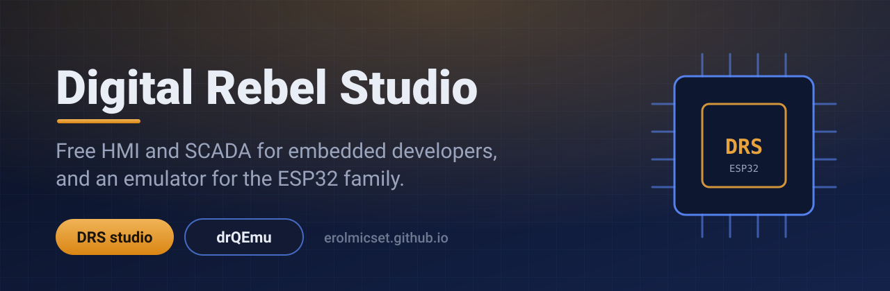
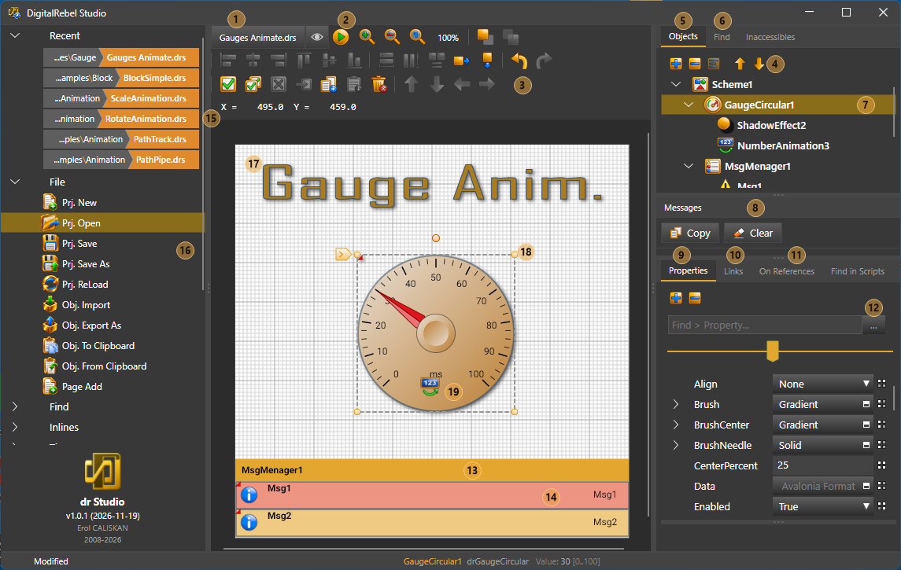
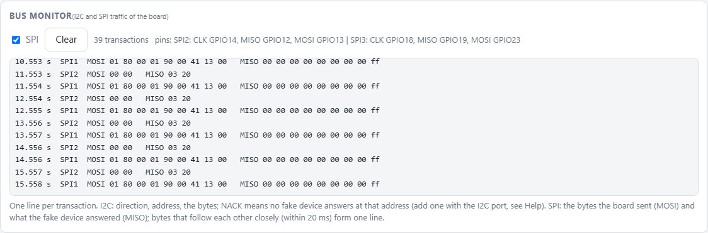

  

  <a href="https://erolmicset.github.io/"><b>Website</b></a> ·
  <a href="https://erolmicset.github.io/DRS.html">DRS</a> ·
  <a href="https://erolmicset.github.io/drQEmu.html">drQEmu</a> ·
  <a href="https://erolmicset.github.io/DRSDownload.html">Download</a> ·
  <a href="https://github.com/ErolMicset/ErolMicset.github.io/discussions">Discussions</a>

# Digital Rebel Studio

Software for people who program boards. A visual studio that gives any board a panel, and an emulator that runs the board's program on your PC.

> Both projects are in **beta**: still being tested, so something may not work as you expect and behaviour may change in later versions.

## DRS: HMI, SCADA and IoT panels

A free visual studio for HMI, SCADA and IoT panels. Any board you program, with the Arduino IDE or in your own firmware, gets a panel: ESP32, Arduino, Atmel (AVR), PIC, Raspberry Pi, Pico, Radxa, LattePanda and other embedded boards, over serial, TCP, Bluetooth, Modbus or the LZ protocol.

- **Design by dragging.** Components, object tree and property editor; links, rung blocks and a built-in JavaScript engine react to events and reach every component by name.
- **Industrial and IoT protocols.** Modbus master, S7 client, OPC UA client (browse and import nodes), MQTT client, IP cameras. Tag import sets and a Link Wizard build the screen from the address map.
- **Databases.** Firebird, PostgreSQL, MySQL and MSSQL, with queries, grids, reports and trend charts. Firebird needs no client library installed.
- **Alarms, change log, users, reports, printing.**
- **Windows, Linux and Android.** No accounts, no subscriptions, no licence servers.

## drQEmu: the ESP32 family on your screen

Runs the program you compiled for an **ESP32, ESP32-S2, S3, C3, C5, C6, H2 or P4** on your PC. The chip is read from the image: one program file, any of the eight. Pins, the I2C and SPI buses and the chips on them are drawn in a browser page.

| Chip | Core | Highlights |
| --- | --- | --- |
| ESP32 | 2 x Xtensa LX6 | touch, DAC, PSRAM, PCNT, MCPWM, TWAI (CAN), I2S, AES / RSA, OTA, WiFi |
| ESP32-S2 / S3 | Xtensa LX7 | touch, PSRAM, OTA, WiFi; S3 also drives 8 bit parallel and RGB 800 x 480 displays |
| ESP32-C3 / C5 / C6 | RISC-V | analog calibration, watchdogs, sleep, WiFi |
| ESP32-H2 | RISC-V | 802.15.4 with Zigbee and a Thread leader, Bluetooth LE |
| ESP32-P4 | 2 x RISC-V with FPU | start-up, pins, PWM, analog, PSRAM, I2C, SPI (beta) |

- **78 chip models to connect**, each answering like the real part so the usual Arduino library works unchanged: displays (SSD1306, ILI9341, ST7789, GC9A01 ...), touch (XPT2046, FT6336, GT911 ...), sensors, clocks, expanders, memories, DHT22, DS18B20, HC-SR04, HX711 and more.
- **Complete HMI boards:** put a display and its touch chip together and you have the 2.8 and 3.5 inch ESP32 boards, the round GC9A01 board and the S3 parallel and RGB boards.
- **Virtual WiFi network**, so programs that scan, join, get an address and reach the network run unchanged.

Radios are not real: WiFi is a virtual network, and there is no air for classic-ESP32 Bluetooth.

## Download

| | |
| --- | --- |
| **DRS** | https://erolmicset.github.io/DRSDownload.html |
| **drQEmu** | https://erolmicset.github.io/drQEmu.html (emulator, flasher for real boards, help page) |

Windows builds are available now. A Linux build of drQEmu follows later.

## Also in the family

- **Olympus PLC:** a developer PLC built around an ESP32 with serial, RS485, Bluetooth, WiFi, a memory card and plug-in modules.
- **Kantar:** a weighing program for the scale house, with gross, tare and net weight slips.

## Learn

- [ESP32 panel tutorial](https://erolmicset.github.io/Tutorial-ESP32.html): ten minutes from board to panel
- [For embedded developers](https://erolmicset.github.io/Embedded.html): boards, LZ protocol, gateway, on-board pins
- [Gallery](https://erolmicset.github.io/DRSGallery.html): screenshots by topic

## Licence

The software is free to download and use, for personal, educational and commercial purposes. The source code is not provided and the software may not be redistributed or sold; see `LICENSE.txt` in each download. Projects you create belong to you.

## Contact

Questions about any project: [open a discussion](https://github.com/ErolMicset/ErolMicset.github.io/discussions) or an [issue](https://github.com/ErolMicset/ErolMicset.github.io/issues/new), or write to us and say which project.

&copy; 2026 Digital Rebel Studio (DRS). A Microset project. Unofficial; not affiliated with Espressif Systems.

---

<b>About this repository: the website source</b>

This repository is the public website, served by GitHub Pages at https://erolmicset.github.io/.

### Contents

| file | |
|---|---|
| `index.html` | the home page: all projects |
| `DRS.html` | the DRS page |
| `site.css` | the dark look shared by every page (loaded after the page's own style) |
| `lzflow.js` | the DRS - LZ - device animation, used by DRS.html, PLC.html and drQEmu.html (`data-lzflow`; the device alternates between the PLC and drQEmu) |
| `PLC.html`, `Kantar.html` | the Olympus PLC page and the Kantar page |
| `Tutorial-ESP32.html` | the ten-minute ESP32 panel tutorial |
| `Embedded.html` | the page for embedded developers: boards, LZ protocol, gateway, on-board pins, downloadable example in `examples/` |
| `DRSGallery.html` | the screenshot gallery, with topic filters and a full-size view |
| `images/drs-logo.png`, `images/drs-pcb.png` | the logo and the hero picture, shared by every page |
| `images/drs-favicon.png` | the tab icon (the Designer icon, 48 px) of every page |
| `images/drs/*.png` | screenshots of the DRS studio (lower-case, hyphenated names) |
| `images/drqemu/*.png` | screenshots of drQEmu |
| `DRSDownload.html`, `drQEmu.html` | the two download pages; each has its own zip |
| `DownloadPathList.txt` | one line per zip: `version - zip file name - path`; "Tools" in the name = test servers, "drQEmu" in the name = the emulator |

There is no build step, no framework and no external request: styles, scripts
and icons are all inline. Open `index.html` in a browser to preview it.

### Publishing with GitHub Pages

1. Push this folder as the repository root.
2. **Settings → Pages → Build and deployment**
   - Source: *Deploy from a branch*
   - Branch: `main`, folder: `/ (root)`
3. The site appears at `https://<user>.github.io/<repo>/` within a minute or two.

A repository named `<user>.github.io` is served at `https://<user>.github.io/`
instead, with no sub-path.

### Adding a screenshot

1. Copy the PNG into `images/drs/` (or `images/drqemu/`). Use a lower-case, hyphenated name without
   spaces (`modbus-serial.png`); file names are case-sensitive on GitHub Pages.
2. In `DRSGallery.html`, add one entry to the `SHOTS` list: `images/drs/<name>`, topic
   (`cat`), width and height in pixels (the real size of the file), a title and
   one or two sentences about what the picture shows. Keep entries of the same
   topic together; the list order is the page order.

The topic buttons and their counts update by themselves. A new topic only
needs its name added to `CATEGORIES`.

### Editing the home page

Everything on the DRS page lives in `DRS.html`:

- design tokens (colours, shadows) are CSS custom properties on `:root`, with a
  dark-mode override under `@media (prefers-color-scheme: dark)`
- the hero illustration is inline SVG that reads those same tokens, so it
  follows the theme automatically
- the component catalogue mirrors the Designer toolbox; keep the counts in the
  badges in sync when components are added or removed

